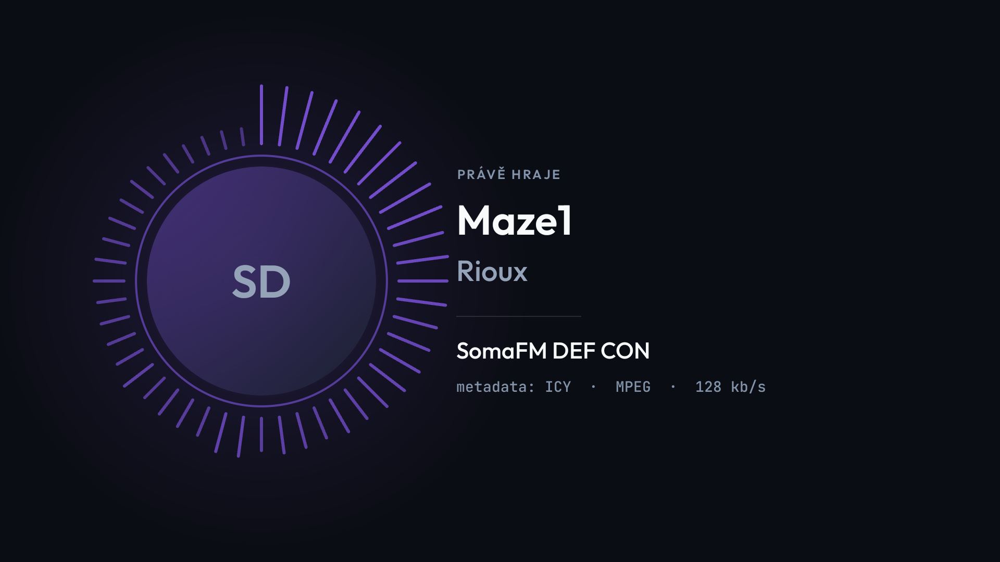
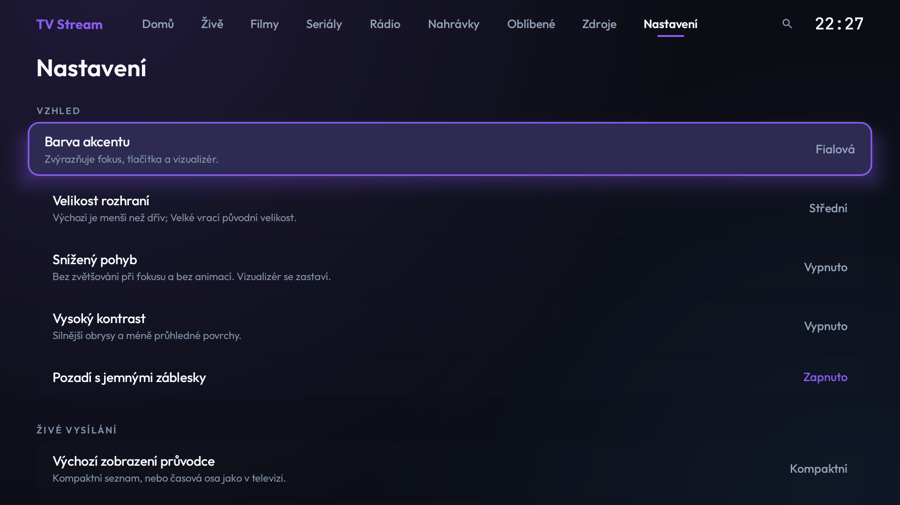
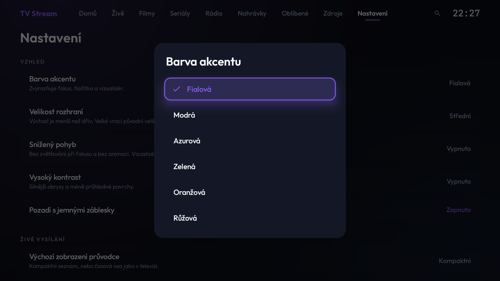

# slopped.strong.tv

Odtučnění, měření a vlastní aplikace pro **Strong 4K Google TV box** (model HP4624gb, Android 14, 32bitový ARM, 2 GB RAM), vše přes `adb`, bez rootu.

> **Upřímně:** velká část kódu i dokumentace vznikla s AI asistentem (odtud „slopped“). Funguje to na jednom konkrétním boxu a je to ověřené na něm; na jiném zařízení to vyzkoušej opatrně a zálohuj si, co jde.

| | |
|---|---|
| [`debloat/`](debloat) | skripty a záznam všeho, co se na boxu změnilo (včetně příkazů pro vrácení) |
| [`apps/`](apps) | tři vlastní aplikace pro Android TV: **TV Nástroje**, **Odjezdy TV**, **TV Stream** |

<p>
  
  
  
</p>

## 1) Debloat a optimalizace boxu (`debloat/`)

Pravidla, která platila celou dobu: žádný root, žádný bootloader unlock, žádný reset do továrního nastavení.
Nikdy se nesahalo na `gms`, `vending`, `systemui`, `tv.settings`, `droidlogic*`, `mft.rcupair`, `sdt.ota`, `sdt.upgrade`, Google TV launcher ani na streamovací aplikace.

- `debloat.ps1`, `debloat_extra.ps1` – vypnutí zbytečných balíčků pro uživatele 0 (`pm disable-user`), vše vratné.
- `measure.ps1` + `measure_*.txt` – měření před a po (RAM, procesy, startovní doba).
- `changes.md` – **každá změna s příkazem pro vrácení**. Číst jako první.
- `backup/` – seznamy balíčků a nastavení před zásahem (bez identifikátorů zařízení).

```powershell
# jednou: na boxu zapnout Ladění přes síť, pak
adb connect <IP-boxu>:5555
# adb.exe stačí mít v PATH (nebo vedle skriptu); seznam balíčků si nejdřív přečti v souboru\npowershell -ExecutionPolicy Bypass -File .\debloat\debloat.ps1\npowershell -ExecutionPolicy Bypass -File .\debloat\debloat.ps1 -Restore   # vrátí vše zpět
```
Skripty jen vypínají balíčky; kromě `-Restore` jde jednotlivě `adb shell pm enable --user 0 <balíček>` (viz `changes.md`).

## 2) Vlastní aplikace (`apps/`)

Jeden Gradle projekt (AGP 9, Kotlin, bez Compose, ovládání D-padem).

| modul | aplikace | co umí |
|---|---|---|
| `app` | **TV Nástroje** | monitor RAM / úložiště / CPU / uptime, přepínač animací, seznam aplikací |
| `odjezdy` | **Odjezdy TV** | odjezdová tabule (WebView), spořič obrazovky |
| `stream` | **TV Stream** | přehrávač IPTV zdrojů: **Xtream Codes**, **TVHeadend** (Basic/Digest, nahrávky), **Stalker / Ministra** (MAC portály) |

**TV Stream** je jen přehrávač: žádný obsah neposkytuje a žádný nevolí. Používej ho **jen se zdroji, ke kterým máš oprávnění** (vlastní TVHeadend, vlastní Ministra, předplatné u poskytovatele).
Design je minimalistický, bez zbytečných prvků (v Nastavení jde změnit velikost rozhraní). Umí: živé TV s programem (kompaktní průvodce i časová osa), filmy a seriály s pokračováním, rádio s vizualizérem podle skutečného zvuku a ICY/ID3 metadaty, oblíbené, hledání, nastavení zdrojů z telefonu (QR + PIN), více zdrojů najednou, 60 000+ kanálů plynule.
Hesla jsou šifrovaná klíčem v Android Keystore, v logu ani v cache zdrojů nejsou.

### Build
```powershell
$env:JAVA_HOME = "C:\Program Files\Android\Android Studio\jbr"   # nebo jakékoli JDK 17+
cd apps
.\gradlew.bat :stream:assembleRelease :stream:testDebugUnitTest
adb install -r stream\build\outputs\apk\release\stream-release.apk
```
Release je podepsaný debug klíčem (stačí pro instalaci přes adb).

### Dokumentace
- [`apps/docs/DESIGN_SYSTEM.md`](apps/docs/DESIGN_SYSTEM.md) – tokeny, komponenty, přístupnost
- [`apps/docs/VISUAL_REVIEW.md`](apps/docs/VISUAL_REVIEW.md) – vizuální kontrola na skutečném zařízení
- [`apps/docs/PROVIDER_ARCHITECTURE.md`](apps/docs/PROVIDER_ARCHITECTURE.md) – jak se mluví s Xtream, TVHeadend, Stalker/Ministra
- [`apps/docs/RADIO_METADATA.md`](apps/docs/RADIO_METADATA.md), [`apps/docs/REMOTE_NAVIGATION.md`](apps/docs/REMOTE_NAVIGATION.md)
- [`apps/scripts/fake-iptv-server.mjs`](apps/scripts/fake-iptv-server.mjs) – zkušební server (Xtream, TVHeadend, Stalker) pro testy bez skutečného poskytovatele

## Stav a omezení
- Testováno na jednom boxu (1080p). Časová osa s bloky pořadů a čtení TalkBackem ověřeny nebyly (viz `VISUAL_REVIEW.md`).
- Rádio na pozadí běží bez systémové služby (MediaSession); systém může proces ukončit.
- Stalker seriály podle protokolu, ověřeny na jednom portálu.
- Aplikace třetích stran (VLC, X-plore, LocalSend, Projectivy, TV Bro) v repozitáři **nejsou**; zdroje a ověření podpisu jsou v `debloat/changes.md`.

## Licence
Zatím není stanovená; do té doby platí „všechna práva vyhrazena“. Písma Outfit a JetBrains Mono jsou pod SIL OFL (`apps/stream/src/main/assets/fonts/LICENSES.txt`).
